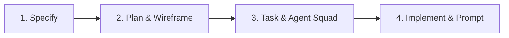

# 📱 App Wireframer (AI Spec & Task Architect)

> **Ubah ide aplikasi abstrak menjadi dokumen spesifikasi teknis, wireframe interaktif, dan prompt AI siap pakai hanya dalam 4 langkah terstruktur.**

---

## 🌟 Tentang Proyek

Sering kali saat kita memiliki ide membuat aplikasi, kita bingung harus mulai dari mana. Menjelaskan ke programmer atau ke model AI (*prompting one-shot*) sering menghasilkan arsitektur yang berantakan, tidak terstruktur, dan rentan eror (*hallucination*).

**App Wireframer** adalah platform *interactive specification builder* yang bertindak sebagai kombinasi **Product Manager + UI/UX Designer + Tech Lead AI** pribadi Anda. Aplikasi ini memandu Anda merancang produk digital mulai dari validasi ide, skema basis data, wireframe visual perangkat bergerak, hingga pembagian tugas untuk *Solo Developer* maupun *Multi-Agent AI Squad*.

---

## 🚀 4 Tahapan Utama (Workflow)



### 1. Tahap 1: Spesifikasi (Specify)
- **Input Ide Produk**: Masukkan nama aplikasi, deskripsi singkat, target pengguna, masalah yang ingin diselesaikan, serta lokalisasi (bahasa, mata uang, unit pengukuran).
- **AI Spec Generation**: Model Gemini menghasilkan *Ringkasan Eksekutif*, *Cerita Pengguna (User Stories)* berformat baku, dan *Kebutuhan Fungsional Utama*.
- **Editor & Quick Actions**: Edit teks secara instan, tambah/hapus *User Story*, muat contoh ide Bahasa Indonesia/Inggris, atau terjemahkan seluruh proyek dengan AI.

### 2. Tahap 2: Perencanaan & Wireframe Visual (Plan)
- **Matriks Fitur & NFR**: Pilih fitur umum (Autentikasi, Notifikasi Push, Obrolan, Mode Offline, dll.) dan tentukan kualitas sistem (Keamanan, Performa, Skalabilitas).
- **Interactive Low-Fi Wireframe Mockup**: Menampilkan pratinjau kanvas layar ponsel (*smartphone*) interaktif dengan blok-blok komponen UI (`header`, `card`, `hero`, `list`, `chart`, `tabs`, `chat`, `form`, dll.). Mengklik salah satu elemen akan membuka *Component Inspector*.
- **Arsitektur Data & Alur**: AI menyusun usulan skema tabel *Data Models* (format Markdown), integrasi API pihak ketiga, dan diagram *User Flow Journey*.

### 3. Tahap 3: Pembagian Tugas & Tim Agen AI (Task)
- **Modular Task Breakdown**: Menguraikan spesifikasi menjadi daftar pekerjaan teknis yang dilengkapi dengan *Acceptance Criteria*, *Required Tools*, dan *Dependencies*.
- **Alokasi Skuad Agen AI**: Menugaskan tugas ke peran agen spesialis:
  - 🏛️ *Database & Data Architect*
  - ⚙️ *Backend & API Specialist*
  - 🎨 *Frontend UI Specialist*
  - 🛡️ *Auth & Security Specialist*
  - 🧪 *QA & Test Engineer*
  - 🎯 *Full-Stack Generalist*
- **Dual View Mode**:
  - **Solo Developer Pipeline**: Urutan eksekusi bertahap secara linear (1, 2, 3...).
  - **Multi-Agent Squad View**: Pengelompokan tugas berdasarkan keahlian domain agen AI.

### 4. Tahap 4: Hasil Akhir & Prompt Rekayasa AI (Implement)
- **Master Prompt Solo Dev**: Prompt komprehensif tunggal untuk ditempelkan ke ChatGPT, Claude, atau Gemini.
- **Direktif Agen Terisolasi**: Prompt instruksi mandiri khusus per agen pekerja.
- **Cetak Biru Orkestrator**: Panduan koordinasi untuk framework orkestrasi agen (LangChain, CrewAI, AutoGen, Antigravity).
- **Spesifikasi Markdown Lengkap**: Dokumen rekayasa perangkat lunak siap unduh (`.md`) atau salin ke papan klip.

---

## 🛠️ Tech Stack & Arsitektur

- **Frontend**: React 18 (Vite), TypeScript, Tailwind CSS, Lucide Icons
- **Backend API Proxy**: Express.js (Node.js) untuk memproteksi *API Key* server-side
- **AI Model Engine**: Google Gemini API (`@google/genai` dengan model `gemini-2.5-flash`)
- **Penyimpanan Lokal**: IndexedDB dengan mekanisme *debounced auto-save* & *multi-project management*
- **Internasionalisasi (i18n)**: Dukungan dwibahasa penuh (Bahasa Indonesia & English)

---

## 📦 Menjalankan Proyek Secara Lokal

### Prasyarat
- Node.js versi 18 ke atas
- NPM atau Yarn
- Kunci API Google Gemini ([Dapatkan di Google AI Studio](https://aistudio.google.com/))

### Langkah Instalasi

1. **Clone repository ini:**
   ```bash
   git clone https://github.com/username/app-wireframer.git
   cd app-wireframer
   ```

2. **Pasang dependensi:**
   ```bash
   npm install
   ```

3. **Konfigurasi Environment Variable:**
   Salin file `.env.example` ke `.env`:
   ```bash
   cp .env.example .env
   ```
   Tambahkan kunci API Gemini Anda di file `.env`:
   ```env
   GEMINI_API_KEY=your_actual_gemini_api_key_here
   ```

4. **Jalankan server pengembangan:**
   ```bash
   npm run dev
   ```
   Buka browser Anda di `http://localhost:3000`.

5. **Build untuk Produksi:**
   ```bash
   npm run build
   npm start
   ```

---

## 📂 Struktur Proyek

```text
├── components/
│   ├── stages/
│   │   ├── SpecifyStage.tsx   # Tahap 1: Input ide & kebutuhan
│   │   ├── PlanStage.tsx      # Tahap 2: Wireframe visual & data models
│   │   ├── TaskStage.tsx      # Tahap 3: Pembagian tugas & squad agen
│   │   └── ImplementStage.tsx # Tahap 4: Export prompt & dokumen spec
│   ├── AgentBadge.tsx         # Tag badge peran agen AI
│   ├── LanguageSwitcher.tsx   # Pengalih bahasa UI
│   ├── ProgressBar.tsx        # Bilah progres 4 tahap
│   └── ProjectModal.tsx       # Manajer proyek & IndexedDB browser
├── services/
│   ├── dbService.ts           # Logika penyimpanan IndexedDB
│   ├── geminiService.ts       # Klien komunikasi ke backend API Gemini
│   └── i18n.tsx               # Kamus terjemahan (ID/EN) & konteks
├── server.ts                  # Backend Express proxy ke Google GenAI
├── types.ts                   # Definisi tipe TypeScript
├── sampleData.ts              # Dataset contoh bawaan (ID & EN)
├── PRD.md                     # Dokumen Product Requirement formal
└── VIBE_CODING_PROMPT.md      # Master prompt untuk mereplikasi aplikasi
```

---

## 📄 Lisensi
Didistribusikan di bawah Lisensi MIT. Bebas digunakan untuk keperluan komersial maupun pembelajaran.
